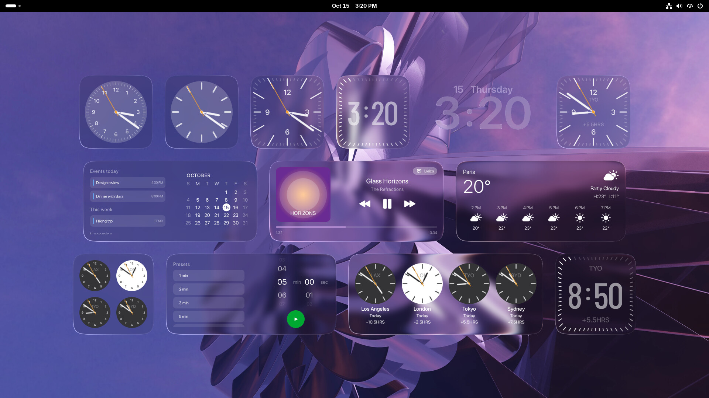
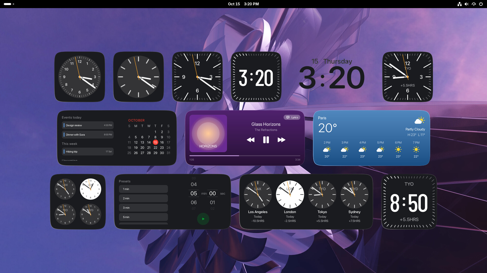

# Liquid Glass Widgets for GNOME

A GNOME Shell extension port of [liquidglass-kde-widgets](https://github.com/jaxparrow07/liquidglass-kde-widgets)
(macOS-style desktop widgets on a liquid-glass background). Licensed GPL-3.0, like the original.





*Every widget on GNOME Shell 50, in Glass style (top) and Solid style (bottom). The music track and calendar
events are sample data. The wallpaper is Fedora's "Montclair".*

## Widgets

All the KDE widgets are ported. Clocks II, III, Digital, Glass Text and the world clocks are off by default; switch
them on in the settings' Clocks page.

- **macOS Clock I, II, III** (`clock-analog`, `clock-analog-2`, `clock-analog-3`): one class with a variant per
  clock. Clock III's ticks follow the glass edge.
- **macOS Clock Glass Text** (`clock-glass-text`): the digits are the glass; the wallpaper refracts through every
  stroke. Five fonts (Soft, Rounded, Rails, New York, Stencil) and an optional tinted text overlay.
- **macOS Clock Digital** (`clock-digital`): its tick ring doubles as a seconds hand. Uses GNOME's 12/24-hour setting.
- **World clocks** (`city-1`, `city-2`, `city-3`, `city-digital`): City I and II show up to four cities as a grid
  or a row with names, each dial light by day and dark by night in its city. City III and Digital show one city
  on the Clock III and Digital faces. Pick cities in the settings by searching city names or any system time zone.
- **macOS Calendar** (`calendar`): the month grid and, in the Wide layout, upcoming events from your GNOME
  calendars (including online accounts) grouped as today, this week and upcoming.
- **macOS Weather** (`weather`): Small, Medium and Large layouts. Forecasts come from
  [Open-Meteo](https://open-meteo.com) (CC BY 4.0), so there is no account or API key. Pick your city in the
  settings with **Search for a city**.
- **macOS Music** (`music`): now playing for any MPRIS player (Spotify, browsers, VLC, …), in Square, Wide, Bar
  and Tall layouts. It has a seek bar, an album-art flip on track change, and glass that takes on the album's colors.
  Wide and Tall can show synced lyrics from [LRCLIB](https://lrclib.net), which are only looked up while the lyrics
  view is open.
- **macOS Timer** (`timer`): drum pickers (scroll or drag them), rolling-digit countdown, and a preset list in the
  wide layout. A running timer keeps counting and rings while the screen is locked, and comes back after a log out.

Tested on GNOME Shell 50 (Fedora 44, Wayland).

## Install

```bash
./install.sh              # copy to ~/.local/share/gnome-shell/extensions, install the font, enable
./install.sh --uninstall
```

On Wayland, GNOME Shell only loads new or updated extension code at login, so log out and back in after
installing or updating. Settings changes apply live.

- **Move:** drag the widget with the left mouse button.
- **Menu:** right-click it (Glass Style, Lock Position, Widget Settings…).
- **Settings:** `gnome-extensions prefs liquidglass-widgets@local`, or the Extensions app.

## How it maps to the KDE version

| KDE (Plasma applet) | GNOME (this extension) |
|---|---|
| `PlasmoidItem` on the desktop containment | `St.Widget` in `Main.layoutManager._backgroundGroup` (above the wallpaper, below windows) |
| Wallpaper via `Plasmoid.containment.wallpaperGraphicsObject` | Own `Background.BackgroundManager` per widget, offset to the widget's screen position |
| Dual Kawase blur chain (`ShaderEffectSource`s) | `Shell.BlurEffect` on a padded box behind the glass |
| `liquidglass.frag` (Qt RHI, `.qsb`) | Same math as a Cogl GLSL snippet in `lib/glass.js` (`Shell.GLSLEffect`) |
| `TextGlass.qml` (mask → blur → glyph SDF shaders) + `liquidglasstext.frag` | `lib/glyphField.js` builds the same field on the CPU once a minute; `lib/textGlass.js` keeps it beside the wallpaper in one offscreen texture for its shader |
| `MacOSColors.qml` | `lib/colors.js` |
| kcfg `main.xml` + config QML pages | GSettings schema + libadwaita `prefs.js` |
| QML `Canvas` hands, 16 ms timer | `St.DrawingArea` per hand, rotated each frame by a `Clutter.Timeline` |
| Calendar/weather QML layouts | One `St.DrawingArea` per card, painted with cairo + Pango (`lib/draw.js`) |
| `WeatherData.qml` (`XMLHttpRequest`) | `lib/weatherData.js` (libsoup 3), times in the forecast location's own time zone |
| Free resizing of the applet | Size setting, plus a layout choice for the weather and the timer |
| `PlasmaClock.Clock` per time zone | `GLib.TimeZone` / `GLib.DateTime`, refreshed each minute so DST changes are picked up |
| Plasma calendar `EventPluginsManager` (Akonadi) | `helpers/calendar-events.js`, a separate gjs process reading Evolution Data Server, run every 10 minutes by `lib/calendarEvents.js` |
| Plasma `Mpris2Model` | `lib/mpris.js` (Gio D-Bus proxies; picks the playing or most recently active player) |
| QML `Image` + `MultiEffect` for album art | `lib/albumArt.js`: GdkPixbuf → cairo surface, median-cut palette as in the KDE widget |
| Timer state in the plasmoid, KNotification | `lib/timerModel.js` owned by the extension and saved in GSettings; a MessageTray notification with the `alarm-clock-elapsed` sound |

Glass settings (style, appearance, shape and glass sliders) are shared by all widgets; position and size are per widget.

The extension also runs on the lock screen (`"session-modes": ["user", "unlock-dialog"]`) so the timer can ring
there. All widgets are destroyed while the screen is locked and rebuilt on unlock; only the timer model keeps running.

Calendar and weather refresh on a `GnomeDesktop.WallClock` minute tick, so the day rollover and forecast refresh
still happen after a suspend. Weather data is refetched every 30 minutes, and failed fetches retry with backoff.

## Layout

```
extension/
  extension.js              enables/disables widgets from settings
  prefs.js                  settings window
  lib/glass.js              LiquidGlass actor + shader
  lib/textGlass.js          text-shaped glass (Glass Text clock)
  lib/glyphField.js         glyph coverage -> edge normal + depth field
  lib/desktopWidget.js      base class: placement, drag, menu, style
  lib/colors.js             color tokens
  lib/draw.js               cairo/Pango text and PNG helpers
  lib/squircle.js           tick positions along the glass edge (Clock III, Digital)
  lib/weatherData.js        Open-Meteo client and weather view model
  lib/timerModel.js         countdown state, alarm and notification
  lib/canvasButton.js       clickable drawing area (timer and music buttons)
  lib/mpris.js              media players over D-Bus
  lib/albumArt.js           album art loading and color sampling
  lib/lyrics.js             LRCLIB client and LRC parser
  lib/calendarEvents.js     runs the events helper and keeps the latest events
  helpers/calendar-events.js  reads events from Evolution Data Server (separate process)
  lib/worldTime.js          city codes/names for time zones (KDE's cities.js) and per-zone time
  widgets/clockAnalog.js    the analog clocks (I, II, III)
  widgets/clockDigital.js   the digital clock
  widgets/clockGlassText.js the Glass Text clock
  widgets/worldClock.js     the world clocks (City I, II, III, Digital)
  widgets/calendar.js       the calendar
  widgets/weather.js        the weather card
  widgets/timer.js          the timer (pickers, countdown, buttons, presets)
  widgets/music.js          the music player (layouts, seek bar, lyrics view)
  icons/                    weather icon sets and music controls (from the KDE repo)
  schemas/                  GSettings schema
fonts/                      SF Pro Rounded, SF Pro Display Regular/Light/Thin, Barlow Condensed Medium and the
                            five Glass Text fonts (installed to ~/.local/share/fonts)
```

## Adding another widget

Subclass `DesktopWidget` (see `widgets/clockAnalog.js`, or `widgets/calendar.js` for a card painted in one
`St.DrawingArea`), add `<name>-enabled/-x/-y/-size` keys to the schema, add it to `WIDGETS` in `extension.js` and a
group in `prefs.js`. A non-square widget overrides `sizeKeys()` and `readSize()`; `defaultPosition()` picks where it
first appears.

## Testing without logging out

Install `mutter-devkit` (`sudo dnf install mutter-devkit`) and run a nested shell in a window:

```bash
dbus-run-session gnome-shell --devkit --wayland
```

## Notes for shader work

Mutter pads offscreen effect textures by 3 px (2 before the actor, 1 after; see
`clutter_actor_box_enlarge_for_effects`). Both glass shaders get the actor's real rectangle in that texture as a
uniform (`effectFrame()` in `lib/glass.js`). Without it, samples near the edges read the empty padding as black.
